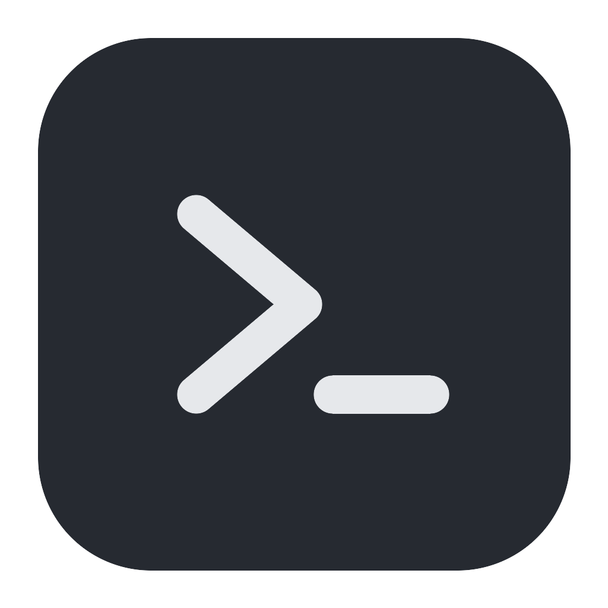

<p align="center">
  
</p>

<h1 align="center">Atur Terminal</h1>

<p align="center">A terminal multiplexer for developers and AI coding agents: persistent sessions, split panes, projects, remote servers. Part of <strong>Atur</strong> by Joyo Digitama.</p>

Atur Terminal is a fork of [Muxy](https://github.com/muxy-app/muxy) (MIT), built with Rust, GPUI and
libghostty. Terminal sessions can also run on [herdr](https://github.com/herdrdev/herdr) (Apache-2.0),
which it uses as an external process; see [the herdr backend](docs/tech/herdr-backend.md).
It is not affiliated with or endorsed by the Muxy or herdr projects.

## What changed from Muxy, and what did not

**Renamed:** the app, window and product name ("Atur Terminal"), the macOS bundle
(`Atur Terminal.app`, id `com.joyodigitama.atur-terminal`, executables `atur-terminal`, `atur-term` and
`atur-term-server` in `Contents/MacOS`), Linux desktop entries and window class (same id), the
binaries (`atur-terminal` desktop app, `atur-term` CLI, `atur-term-server`), every environment
variable (`MUXY_*` is now `ATUR_TERM_*`, for example `ATUR_TERM_DIR`), the data directory
(`~/.local/state/atur-terminal` on Linux, `~/Library/Application Support/Atur Terminal` on macOS; beta
and dev builds use `-beta`/`-dev` or ` Beta`/` Dev` variants), package and asset names
(`AturTerminal-*`, `atur-terminal_*.deb`, `atur-terminal-*` archives), the install script
(`install-atur-terminal.sh`), menus, dialogs, CLI messages, the About screen (with the "Based on
Muxy" and herdr credits), and the update feed (`dzulfikar08/atur-terminal` releases).

**Migration:** on first start, if the new data directory does not exist and the matching Muxy one
does (`muxy`, `muxy-beta`, `muxy-dev` on Linux; `Muxy 2`, `Muxy Beta`, `Muxy Dev` on macOS), Atur
Terminal copies `server.toml`, `catalog.json`, `remote.json`, `backend.toml` and `herdr.json` from
it. The old directory is never modified or moved, and sessions, sockets, logs and locks are not
copied. Nothing is copied when `ATUR_TERM_DIR` is set. Because the socket now lives in the new
directory, **stock Muxy clients no longer find an Atur Terminal server**; the wire protocol itself
is unchanged. Scripts and tools that used the `muxy*` binaries or `MUXY_*` variables must be
updated.

**Left unchanged ("kept for compatibility"):** Cargo crate and package names (`muxy-*`) and Rust
identifiers, the project-level `.muxy/` directory (`.muxy/layouts`, `.muxy/worktree.json`),
`~/.muxy/worktrees`, `~/.config/muxy/*` extension and hook paths, the `.muxy` backup file
extension, the `"muxy"` key in extension `package.json` manifests, the `com.muxy.app` and
`app.muxy.*` defaults-domain keys used to import old Muxy settings, the "Muxy" and "Muxy Light"
theme names, the `Muxy 1.x` legacy import strings, and the license and notice attributions
("Based on Muxy").

**Icon:** Muxy's logos and icons were removed. `packaging/macos/AppIcon.png` is a neutral
placeholder (a terminal prompt on a dark tile), not final artwork.

## Install

Download from the [latest release](https://github.com/dzulfikar08/atur-terminal/releases/latest) and verify
against `SHA256SUMS`.

| Platform | Asset |
| --- | --- |
| macOS 14+, Apple silicon | `AturTerminal-<version>-arm64.dmg` |
| macOS 14+, Intel | `AturTerminal-<version>-x86_64.dmg` (attached when its build succeeds) |
| Linux x86_64, Ubuntu 24.04 | `atur-terminal_<version>_amd64.deb`, `AturTerminal-<version>-linux-x86_64.AppImage` or `atur-terminal-desktop-<version>-linux-x86_64.tar.gz` |
| CLI and server only, Linux x86_64 (glibc 2.35+) | `atur-terminal-<version>-linux-x86_64.tar.gz` |
| CLI and server only, macOS | `atur-terminal-<version>-macos-<arch>.zip` |

See [Getting started](docs/user-guide/getting-started.md) for the Linux installers, the install script
and upgrading from Muxy.

### macOS: Gatekeeper

Release builds are Developer ID signed and notarized when the signing secrets are configured in
CI, and then open normally. Builds made without those secrets are **ad-hoc signed and not
notarized**, and macOS blocks their first launch. In that case, after dragging **Atur Terminal** to
`/Applications`, either Control-click it and choose **Open**, or run once:

```bash
xattr -dr com.apple.quarantine "/Applications/Atur Terminal.app"
```

In-app updates on macOS require a Developer ID signature; with an unsigned build, download the new
DMG instead. The Intel build is made on a native Intel runner after the release is published.

## Releases and CI

- `.github/workflows/ci.yml`: Linux (headless and desktop) and macOS checks on pushes to `main`,
  `atur-terminal` and `feat/herdr-backend`, and on pull requests.
- `.github/workflows/atur-release.yml` (with `.github/workflows/build-release.yml`): pushing a tag
  `atur-vX.Y.Z-N` (or running the workflow manually with that tag) builds Linux x86_64 and macOS
  arm64, stamps `X.Y.Z` into the binaries (`N` is the release revision), and attaches the archives,
  installers, `update.json` and `SHA256SUMS` to a GitHub Release. The macOS Intel build is added
  after publishing and never blocks the release.

```bash
git tag atur-v2.2.0-1 && git push origin atur-v2.2.0-1
```

The workflows were adapted from Muxy's. Developer ID signing and notarization of the macOS builds
run when the signing secrets are configured. The Sparkle update for Muxy 1.x, Homebrew and Discord
publishing, arm64 Linux and the mobile SDK were removed.

## Build from source

Rust 1.92, Zig 0.15.2 and, on Linux, the packages listed in `.github/workflows/ci.yml`:

```bash
cargo build --release -p muxy-app -p muxy-cli -p muxy-server
```

See [CONTRIBUTING.md](CONTRIBUTING.md) and the [docs](docs/README.md).

## Licence and credits

- [LICENSE](LICENSE): MIT. Copyright (c) 2026 Muxy, and (c) 2026 Joyo Digitama for the modifications.
- [NOTICE](NOTICE): attributions for Muxy and herdr.
- [THIRD_PARTY.md](THIRD_PARTY.md): vendored and bundled components and their licences. herdr's
  agent-detection manifests are adapted under Apache-2.0; see
  `crates/muxy-server/src/detection/THIRD_PARTY.md` and `LICENSE-herdr`.

Based on Muxy by the Muxy contributors. herdr by its contributors.
