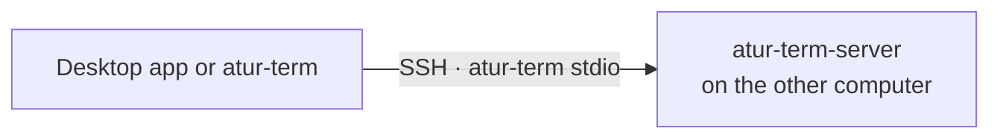

# Remote Servers

Atur Terminal can work with projects on other computers over SSH. Each computer runs its
own `atur-term-server`, so remote terminals keep running when you disconnect, just
like local ones. Remote projects sit in the same sidebar as local ones, marked
with their server.



## Requirements

- SSH access to the computer with your keys, agent, or certificates. The
  desktop app also supports password logins.
- A trusted host key. Run `ssh <host>` once to accept it.
- Atur Terminal [installed there](../user-guide/getting-started.md#cli-and-server-only),
  on `PATH` or in `~/.local/bin`, at a version that speaks the same protocol as yours.
- macOS 14 or newer, or Linux with glibc 2.35 or newer, on x86_64 or ARM64.

On Linux hosts that end your processes when you log out, run
`loginctl enable-linger` so the server keeps running after SSH disconnects.

## In the desktop app

1. Open the **Remote** section at the bottom of the sidebar and choose
   **Add Server…**.
2. Enter the SSH host (a host name, address, or `~/.ssh/config` alias), and
   optionally the user, port, and identity file.
3. Choose **Test Connection**. If Atur Terminal isn't installed there, the app offers to
   install the same version into `~/.local/bin`.
4. Add projects with **Add Project → Remote**, which browses the server's
   folders.

- Passwords are asked when connecting and kept only in memory until you quit.
- A dropped server reconnects on its own, waiting longer each time. It stops
  retrying when it needs you, for example for a password or a new host key.
- **Forget** a server to remove it and its projects from this app. Nothing on
  the server changes.
- The status bar shows the current project's server, with connect, restart, and
  stop.

### Custom SSH commands

If a VM manager or another tool handles SSH for you, turn on **Custom command**
in **Add Server…** (or **Edit…**) and enter its command prefix, for example:

```text
swiftvm ssh my-vm
```

Atur Terminal runs that local program directly and appends its remote command as **one
argument**. The prefix must include the target machine and any flags or `--`
separator your tool needs. Atur Terminal does not add SSH flags, a host, or a port in this
mode. The same prefix is used for Test Connection, installation, normal
connections, and reconnects.

- The tool must accept a remote shell command as its last argument and relay
  stdin/stdout unchanged **without allocating a TTY**. Interactive-shell-only
  tools are not supported. Add your tool's non-interactive/no-TTY flags if needed.
- Authentication and host-key verification belong to the tool. Set them up in a
  terminal first; Atur Terminal's password and identity-file controls do not apply here.
- Single/double quotes and backslashes group arguments, so paths and VM names
  can contain spaces. Shell variables, `~`, wildcards, pipelines, redirects,
  aliases, and command substitutions are not expanded. Use an absolute program
  path if the tool is not on the desktop app's `PATH`.
- Only configure commands you trust: they run locally with your permissions on
  connection and reconnection. Do not put passwords or tokens in the command;
  it is saved in plain text in `settings.toml`.

For tools with a different argument convention, use an executable wrapper
script that accepts the last argument as the remote command and forwards it
without changing stdin/stdout. The remote computer still needs Atur Terminal and the
same OS requirements listed above.

A custom-command entry in `settings.toml` uses `ssh_command` instead of `ssh`:

```toml
[[servers]]
id = "6f9619ff-8b86-4011-b42d-00c04fc964ff" # use a unique UUID
name = "Development VM"
ssh_command = "swiftvm ssh my-vm"
```

## From a shell

Put `--host` first to use another computer's server:

```bash
atur-term --host devbox                 # terminal UI
atur-term --host devbox project list    # any CLI command
atur-term --host ssh://me@devbox:2222   # with a user and port
```

`--host` takes `user@host`, an `~/.ssh/config` alias, or
`ssh://user@host:port`. It never prompts, so use a key or an agent. Folder
arguments must be absolute paths on that computer.

## On slow or unreliable networks

SSH runs over TCP, so one lost packet holds up everything behind it, and a
network that comes and goes ends the connection. Over a link with a round trip of
a second and a few lost packets in ten, typing stalls for seconds. UDP mode
keeps the connection usable there, in the manner of mosh:

- SSH still logs in and starts the server's bridge. Once that works, the
  connection moves to encrypted UDP and SSH is dropped.
- Lost packets are sent again within about a round trip, small ones such as
  keystrokes and echoes are sent more than once up front, and one stall never
  holds up the rest.
- Changing network, such as Wi-Fi to a phone hotspot, or sleeping the laptop,
  keeps the connection. The server waits an hour for you to come back.
- If UDP does not connect within 3 seconds, Atur Terminal carries on over SSH
  as if nothing was asked, and says so once.

Turn it on with **Use UDP on slow or unreliable networks** in the server's
form, or in `settings.toml`:

```toml
[[servers]]
id = "6f9619ff-8b86-4011-b42d-00c04fc964ff"
name = "Devbox"
ssh = "devbox"
udp = true
```

From a shell, add `--udp` after the host, or set `ATUR_TERM_UDP=1`:

```bash
atur-term --host devbox --udp
```

### Firewalls and ports

The server's bridge picks a random UDP port from **60001-61000** for each
connection. Packets travel directly between the two computers, to the host SSH
connects to.

- **Tailscale or another VPN** needs nothing: the virtual network is already open
  between your computers.
- **The plain internet** needs UDP 60001-61000 open in the server's firewall,
  for example `ufw allow 60001:61000/udp`, or the same range in a cloud
  provider's security group. Open fewer ports by narrowing the range.
- **Behind NAT** the server must be reachable on those ports, or by a VPN. Only
  the client's address may change.
- A hotel or office network that blocks UDP falls back to SSH after 3 seconds.

| Setting | Environment variable | Default |
| --- | --- | --- |
| Ports the server may use | `ATUR_TERM_UDP_PORTS=LOW-HIGH` | `60001-61000` |
| Host to send UDP to, if not the SSH host | `ATUR_TERM_UDP_HOST` | the host SSH connects to |
| Seconds the server keeps a connection that went quiet | `ATUR_TERM_UDP_IDLE` | `3600` |
| Seconds before the app gives up on a silent server and reconnects | `ATUR_TERM_UDP_TIMEOUT` | `300` |

These read from the environment of the app or `atur-term` that connects. The
server needs Atur Terminal with UDP support, and an older one falls back to SSH.
[How it works](../tech/udp-transport.md)

## Working with remote files

- Files dropped or pasted into a remote terminal, or sent from the
  [composer](composer.md), are uploaded and their remote path is pasted.
- `Cmd`-clicking a remote file offers a read-only copy on this Mac, or its path.
- Git runs on the server. Pull request features need `gh` installed and signed
  in there.
- AI commit and pull request actions run on this Mac, so they only work when
  the project's folder also exists here.

## Updating

Atur Terminal never updates a remote computer by itself. When versions can't talk, the
app shows the command to run there. To update by hand, follow
the [installation instructions](../user-guide/getting-started.md#cli-and-server-only)
on that computer with `--replace`, choosing the same channel and a compatible version.
