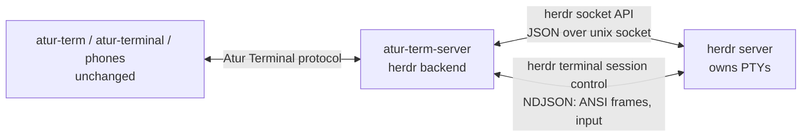

# herdr backend

`atur-term-server` can hand its terminals to a [herdr](https://github.com/herdrdev/herdr) server. Atur Terminal's
apps (desktop, TUI, CLI, phones) connect to `atur-term-server` exactly as before. herdr owns the PTYs and
shells, so restarting `atur-term-server`, or handing herdr itself to a new binary, does not end a terminal.
Like herdr's own UI, it streams only the panes somebody is looking at (see "Streaming only watched sessions").



Nothing is forked: herdr is used through its documented socket API and
`herdr terminal session control`, and the Atur Terminal client protocol is untouched.

## Turning it on

`backend.toml` beside `server.toml` (default `~/.local/state/atur-terminal/`), or the environment:

```toml
kind = "herdr"
herdr_bin = "/usr/local/bin/herdr"                   # default: herdr on PATH
herdr_socket = "/home/me/.config/herdr/herdr.sock"   # default: $HERDR_SOCKET_PATH, else herdr's own
```

`ATUR_TERM_BACKEND`, `ATUR_TERM_HERDR_BIN` and `ATUR_TERM_HERDR_SOCKET` override the file. `kind = "local"` (the
default) keeps local PTYs. The server refuses to start if herdr does not answer `ping`. Over SSH
(`atur-term --host`) the setting is read on the remote machine, where `atur-term stdio` starts the server.

## Where the code is

| Piece | File |
|---|---|
| What an owner needs from a process (`Backing` trait; the local PTY implements it) | `session/backing.rs` |
| herdr socket API client, one connection per request | `herdr/api.rs` |
| Control stream (`herdr terminal session control`): frames, input, resize, mouse, reconnect | `herdr/control.rs` |
| Shared, short-lived `pane.list` copy: title, scrollback size, agent | `herdr/panes.rs` |
| Scrollback via `pane.read` | `herdr/scrollback.rs` |
| Session/project to herdr mapping, `herdr.json` | `herdr/store.rs` |
| Adoption of survivors (saved ids, shell environment, legacy labels) | `herdr/adopt.rs` |
| Creation and the `Backing` implementation | `herdr/mod.rs` |
| Socket API stand-in for tests | `herdr/fake.rs` (test only) |
| Backend selection | `backend.rs` (binary crate) |

## Request inventory

In this mode `atur-term-server` still answers every request. Only requests that touch a terminal's
process or bytes go to herdr; everything else is the existing server code.

| Request / reply / event | Served by |
|---|---|
| `Authenticate`, `IdentifyClient`, `Ping`, remote access, pairing (`Paired`, `RemoteAccess`, `Pairing`) | atur-term-server, unchanged |
| `ReadCatalog`, `MutateProject`, `ListProjectSessions`, `CancelCreation` | atur-term-server catalog, unchanged |
| `ListSessions` | atur-term-server session table; sessions are adopted from herdr at start |
| `CreateSession` | herdr: `workspace.create` (first session of a project; label = project name) or `tab.create`, with the project directory, `ATUR_TERM_*` environment and no tab label; then a control stream |
| `Attach`, `Detach`, `Resize` (+ `ScreenFrame`, `FrameAck`, `Snapshot`, `Resized`) | atur-term-server owner. The first attach opens herdr's control stream and is answered when its first frame has painted the owner's terminal; the last detach closes the stream after 5 s. Resize goes to the control stream (`terminal.resize`) while it is open and is applied when it opens otherwise |
| `WriteInput`, `Input`, `TerminalInput`, `Paste` | atur-term-server encodes keys. Bytes go to `terminal.input` while the stream is open and to `pane.send_text` otherwise (no stream is opened for input alone). Pastes are always bracketed because herdr re-wraps for the application's own mode |
| `Mouse` | `terminal.mouse` / `terminal.scroll` on the control stream |
| `CellSize` | `terminal.resize` carries `cell_width_px`/`cell_height_px` |
| `HistoryPage`, `Search` | herdr `pane.read` (`recent`, `visible`, ANSI) rendered to rows with a scratch libghostty terminal; the row count comes from `pane.list` `scroll.max_offset_from_bottom`. The screen part of a page of an unwatched session is read the same way (`pane.read visible`) and replaces the owner's terminal content first |
| `ReadSavedScreen`, `SavedHistoryPage`, `DiscardSession` | atur-term-server archive. A herdr terminal is not checkpointed while it runs (herdr holds the content); the archive is written when the session ends, from `pane.read visible` if nobody was watching |
| `EndSession`, `CloseSession` | herdr `pane.close` |
| `StopServer`, `StopServerIfIdle` | atur-term-server stops; terminals keep running in herdr and are adopted again. `SessionEnded` is **not** sent to clients for them (the stock TUI and app would close the pane and discard the session) |
| `SetTerminalColors`, `ReadServerSettings`, `WriteServerSettings`, `SyncSessionReferences` | atur-term-server, unchanged |
| `Git`, `Files`, `Exec`, `CancelExec` and their watch events | atur-term-server code, unchanged |
| `ReadActivity`, `AcknowledgeActivity`, `ClaimActivity`, activity events | atur-term-server; provider and state come from herdr's `agent` / `agent_status` (see below) |
| Metadata events: title, directory, foreground process, bell, clipboard, input modes, links, prompts, cursor blinking | title: `pane.list`; directory and foreground process: `/proc` (the shell pid from `pane.process_info` once, then the shell's `tpgid`; same host); the rest from the mirror terminal (limits below) |

## Frame source: re-parse herdr's ANSI, not semantic frames

The Atur Terminal owner needs a terminal model (rows, cursor, modes, history indexes, search, graphics). Options:

1. **herdr semantic frames** (`SemanticFrame`/`PaneSurfaceFrame` of herdr's own client protocol).
   They describe herdr's whole UI surface (tabs, borders, sidebar), not one pane's grid, use herdr-internal
   bincode types that are not a published crate, and `terminal session observe|control` negotiates only
   `TerminalAnsi`. Using them would mean linking herdr internals and re-implementing Atur Terminal's terminal model on
   top of a layout surface.
2. **herdr's per-terminal ANSI stream** (`terminal session control`, the documented bridge interface).
   herdr emits a full redraw at attach and then diffs of the visible grid at the requested size.
   The owner feeds them to its existing libghostty terminal, so row diffing, search, links, modes, detection
   and checkpoint code are reused as they are.

Decision: **2**. Measured on 0.9.5, a 120×40 pane running an omp-like workload (10 Hz spinner region,
4 log lines/s):

| | CPU of herdr server (1 core = 100 %) | Frames | Bytes |
|---|---|---|---|
| no observer | 0.5 % | – | – |
| one ANSI observer | 3.2 % (0.9.1: 5.6 %) | 11 /s | 17 KB/s ANSI (24 KB/s JSON+base64) |

The mirror terminal in `atur-term-server` costs about what parsing the PTY bytes costs there (atur-term-server
4.1–4.9 % per busy session in the herdr variant against 4.5–4.8 % with local PTYs, one session). The
herdr server's own cost is what makes the herdr variant dearer overall; see the measurements below.

What the ANSI stream lacks, because herdr renders it from its grid: OSC titles, OSC 133 prompt marks,
OSC 52, bells, DECCKM/bracketed-paste state, scrollback beyond the screen. Those are filled from the API
(title, scrollback) or are limits (below).

## Streaming only watched sessions

herdr itself renders only the panes a client views. `atur-term-server` does the same:

* No `terminal session control` child and no mirror-terminal parsing exist for a session nobody is attached to.
* The first `Attach` opens the stream (`--takeover` at the client's size) and is answered when the first
  frame, a full repaint, has arrived (1.5 s at most). The last `Detach` starts a 5 s grace; then the
  stream is closed with `terminal.release`.
* Unwatched sessions need only cheap API calls: `pane.list` (one shared copy, 200 ms TTL) for title, agent,
  `agent_status`, scrollback size and liveness; `/proc` for directory and foreground process; `pane.read`
  for history, search and the saved screen; `pane.send_text` for input. A terminal that vanished from
  herdr while unwatched is noticed within about a second and the session ends.
* Whatever the owner's terminal holds for an unwatched session is stale; it is reseeded from
  `pane.read visible` before anything reads it (history/search pages, the checkpoint when the session ends).

## Identity mapping

| Atur Terminal | herdr |
|---|---|
| `ProjectId` | one herdr workspace, created with the first session of the project (label = project name, the catalog's, never an id). Stored in `herdr.json` and recovered from the panes of adopted sessions |
| `SessionId` (u64) | one tab holding one pane, **without a label**, so herdr numbers it (1, 2, 3, …) like the tabs the user opens. The pane's `terminal_id` and `pane_id` are stored in `herdr.json`, and the session id is in the shell's environment as `ATUR_TERM_SESSION_ID` |
| Session size | owned by Atur Terminal: the control stream attaches with `--takeover` at the client's size and `terminal.resize` follows every `Resize` |

herdr numbers terminals afresh after a server restart and **re-mints terminal ids on a live handoff**
(observed: `term_…` ids changed, pane ids `w7:p3` and processes did not). So the saved terminal id is only
a hint, and tabs carry no label to find a session by. For every session the Atur Terminal catalog remembers,
adoption (`herdr/adopt.rs`) tries, in order:

1. **The saved ids** in `herdr.json`: the terminal id, then the pane id. The pane id is the durable one, as it
   survives a handoff; both are rewritten when adoption finds the session under other ids.
2. **The shell's environment**: `ATUR_TERM_SESSION_ID` (`MUXY_SESSION_ID` before the rename), read from
   `/proc/<shell pid>/environ` with the `shell_pid` of `pane.process_info` (same host, Linux). It needs no saved
   state, so it also finds sessions after `herdr.json` is deleted. One `pane.process_info` request per pane
   that is checked, once per start.
3. **The tab label** `atur-<id>` or the earlier `muxy-<id>`, for sessions made by builds that labelled their tabs
   (a live server of an earlier build). Only for these is a label read; nothing writes one.

A pane that a saved id (1) points to is taken only if its shell's environment names that session, or cannot
be read (no `/proc`, as on macOS). A readable environment naming another session or none means the id now
belongs to someone else's terminal (ids are reused after a restart) and is skipped, because ending a session
closes its pane. A pane under a legacy label is taken unless its environment names another session. A pane is
adopted by one session only. A running control stream follows its pane id to the new terminal id.

Adoption never renames a tab: herdr's `tab.rename` takes a string and has no way to clear a label back to the
default number, so tabs that carry a legacy label keep it until the user renames them.

## Surviving restarts

* **Restart or crash of `atur-term-server`** (`atur-term server stop`, `kill -9`): sessions are not ended
  (`ExitReason::ServerStopped` detaches), and no `SessionEnded` is sent. On start the registry asks
  herdr for its panes and adopts every session it can match (above), rebuilding the table from herdr
  and the catalog alone: it also works with `herdr.json` deleted, because the shell's environment names
  its session. Clients reconnect and reattach.
* **herdr restart/handoff** (`herdr update --handoff`, API `server.live_handoff`): the API and control
  streams drop. The control stream waits up to 60 s for herdr to answer again (an unreachable herdr is not a
  dead terminal), follows the renumbered terminal through its pane, and reconnects. Processes are
  untouched (same pids).
* **herdr full stop** ends the terminals (herdr's own restore re-creates the shape, not the processes);
  Atur Terminal then reports the sessions ended.

## History, titles, metadata and activity

* History/search: `pane.read` returns only the last N rows with trailing blank rows trimmed, so a page
  reads `history_rows − start + viewport + 1` recent rows and the visible screen and subtracts. Rows older
  than herdr kept come back blank to keep positions aligned. The history generation is constant; a cursor
  becomes stale only when the row count drops below it.
* Title: `terminal_title_stripped` from the shared `pane.list` copy (200 ms TTL, one request for all
  sessions, re-read once when a terminal is missing from the cached list).
* Directory, foreground process: from `/proc` as for local PTYs, using `pane.process_info`
  (`shell_pid`, `foreground_process_group_id`) – herdr must run on the same host as `atur-term-server`.
* Activity: herdr's `agent` label is mapped to an Atur Terminal provider and `agent_status`
  (`working`, `blocked`, `idle|done`, `unknown`) is adopted instead of Atur Terminal's screen detector, including
  the "completed" notification when a working cycle ends. herdr is the only source of agent identity in this mode: Atur Terminal's own `/proc` scan of the process table (the dearest part of an idle session's polling) is skipped, so an agent herdr does not name, or names but Atur Terminal has no provider for, is not reported as an agent.

## Unsupported or limited

* herdr on another host than `atur-term-server`: the socket is local and the metadata comes from local `/proc`.
  (`atur-term --host` is supported: both run on the remote host.)
* OSC 133 prompt marks, OSC 52 clipboard writes, bell and OSC-set titles of full-screen children are not in herdr's ANSI
  frames: prompt jumping is unavailable; titles come from herdr's value.
* Application input modes that herdr does not put into the frames (application cursor keys, kitty keyboard
  protocol, focus events) are not known to the mirror terminal, so arrow keys and similar may be encoded for
  the default mode. Bracketed paste is handled.
* Graphics (Kitty/Sixel) and OSC 8 links appear only if herdr's ANSI re-render carries them; not verified.
* A herdr terminal is checkpointed only when its session ends; "saved screen" of a live session is not refreshed.
* `atur-term server stop --force` leaves herdr terminals running; end them with `atur-term session end`.
* Deleting a project does not remove its herdr workspace.
* The mirror and herdr's own UI contend for the pane size (`--takeover`); the last one to resize wins.
* Handoff of the whole stack on herdr's `update` command needs herdr ≥ 0.9.x with `live_handoff`.
* Where `/proc` has no process environment (macOS), adoption cannot read a shell's session id: it relies on the
  saved terminal and pane ids (the pane id survives a handoff) and on legacy tab labels, so with `herdr.json`
  deleted a session of an unlabelled tab is not found.

## Measurements

Lab: `atur-fork-dist/lab-herdr` (isolated user-level sshd, delay proxy, stock `atur-term` TUI over ssh, omp-like
workload). `patched` is the 2.2.0-latency-ckpt build; `herdr` is this branch with herdr 0.9.5.

CPU, % of one core, mean of 2 reps, 30 s windows, N concurrent omp-like sessions. "watching" is how many
sessions have a client attached: one (the stock TUI) or all (a headless client per session, 80×24). The
herdr rows stream only the watched sessions.

| N | watching | patched (ckpt) total | herdr: atur-term-server + herdr server = total |
|---|---|---|---|
| 1 | 1 | 1.8 | 1.4 + 2.4 = 3.9 |
| 3 | 1 | 3.0 | 1.7 + 3.3 = 5.1 |
| 6 | 1 | 4.8 | 1.5 + 4.0 = 5.6 |
| 1 | all | 1.5 | 1.4 + 1.5 = 2.9 |
| 3 | all | 3.9 | 2.9 + 9.8 = 12.9 |
| 6 | all | 7.5 | 4.2 + 14.1 = 18.6 |

With nothing watched, six busy sessions cost 3.4 % (atur-term-server 0.9, herdr 2.5), under the 4.2 % of the
ckpt build. Before streaming on demand the same six sessions with one TUI cost 65 % (herdr 49 %).
herdr's own cost comes from rendering ANSI for each observed pane (about 2.5 % per watched busy pane
plus about 0.4 % per unwatched busy pane for reading and parsing its PTY), so watching all panes is
still 2–3 times the ckpt build.

Time to first frame of an attach (headless client, spawn to snapshot, 6 attaches, 3 busy sessions):

| variant | stream closed | stream open (1 s after the last attach) |
|---|---|---|
| patched (ckpt) | p50 43 ms, max 62 | – |
| herdr | p50 89 ms, max 162 | p50 45 ms, max 157 |

Echo latency and fps through the TUI over ssh were measured while other builds loaded the machine
(load average 18–57 on 12 cores), so that run is not usable; the unloaded numbers of the eager design
(streaming every session; the attached pane's path is unchanged) were: RTT 0, idle p50/p90 5/21 ms against
5/6 for patched, busy same terminal 21/34 against 13/17, fps 57.6 against 61.9; RTT 50, 55/71 and 73/90
against 53/56 and 62/67. These should be repeated on a quiet machine.

## Proof of restart survival (isolated instances)

Isolated herdr (`HERDR_SOCKET_PATH` under /tmp), isolated `ATUR_TERM_DIR`, the stock `atur-term` TUI in a pty:

1. `atur-term server stop --force` (and `kill -9`) of `atur-term-server` while the TUI shows a session running the
   workload: herdr's shell and workload pids unchanged; `atur-term server start` adopts the session
   (`session adopted from herdr: <id>`), the same TUI keeps drawing the workload (its counter continues).
   Same with `herdr.json` deleted: the session was found by its tab label (this run predates unlabelled tabs; the
   current build finds it by the `ATUR_TERM_SESSION_ID` of its shell, see "Identity mapping").
2. `server.live_handoff` to a copy of the herdr binary while `atur-term-server` keeps running: herdr's pid
   changes, the shell/workload pids do not, terminal ids change (`term_… is now term_…` in the Atur Terminal log),
   all sessions stay `Live`, and typing into a session afterwards works (`echo post-handoff-ok`).

