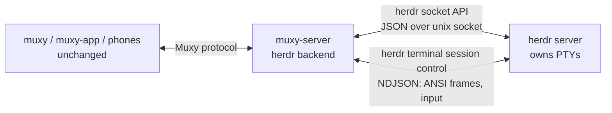

# herdr backend

`muxy-server` can hand its terminals to a [herdr](https://github.com/herdrdev/herdr) server. Muxy's
apps (desktop, TUI, CLI, phones) connect to `muxy-server` exactly as before. herdr owns the PTYs and
shells, so restarting `muxy-server`, or handing herdr itself to a new binary, does not end a terminal.



Nothing is forked: herdr is used through its documented socket API and
`herdr terminal session control`, and the Muxy client protocol is untouched.

## Turning it on

`backend.toml` beside `server.toml` (default `~/.local/state/muxy/`), or the environment:

```toml
kind = "herdr"
herdr_bin = "/usr/local/bin/herdr"                   # default: herdr on PATH
herdr_socket = "/home/me/.config/herdr/herdr.sock"   # default: $HERDR_SOCKET_PATH, else herdr's own
```

`MUXY_BACKEND`, `MUXY_HERDR_BIN` and `MUXY_HERDR_SOCKET` override the file. `kind = "local"` (the
default) keeps local PTYs. The server refuses to start if herdr does not answer `ping`. Over SSH
(`muxy --host`) the setting is read on the remote machine, where `muxy stdio` starts the server.

## Where the code is

| Piece | File |
|---|---|
| What an owner needs from a process (`Backing` trait; the local PTY implements it) | `session/backing.rs` |
| herdr socket API client, one connection per request | `herdr/api.rs` |
| Control stream (`herdr terminal session control`): frames, input, resize, mouse, reconnect | `herdr/control.rs` |
| Shared, short-lived `pane.list` copy: title, scrollback size, agent | `herdr/panes.rs` |
| Scrollback via `pane.read` | `herdr/scrollback.rs` |
| Session/project to herdr mapping, `herdr.json` | `herdr/store.rs` |
| Creation, adoption of survivors, the `Backing` implementation | `herdr/mod.rs` |
| Backend selection | `backend.rs` (binary crate) |

## Request inventory

In this mode `muxy-server` still answers every request. Only requests that touch a terminal's
process or bytes go to herdr; everything else is the existing server code.

| Request / reply / event | Served by |
|---|---|
| `Authenticate`, `IdentifyClient`, `Ping`, remote access, pairing (`Paired`, `RemoteAccess`, `Pairing`) | muxy-server, unchanged |
| `ReadCatalog`, `MutateProject`, `ListProjectSessions`, `CancelCreation` | muxy-server catalog, unchanged |
| `ListSessions` | muxy-server session table; sessions are adopted from herdr at start |
| `CreateSession` | herdr: `workspace.create` (first session of a project) or `tab.create`, with the project directory, `MUXY_*` environment and a tab label `muxy-<id>`; then a control stream |
| `Attach`, `Detach`, `Resize` (+ `ScreenFrame`, `FrameAck`, `Snapshot`, `Resized`) | muxy-server owner; its terminal is fed by herdr's frames (see below); resize goes to the control stream (`terminal.resize`) |
| `WriteInput`, `Input`, `TerminalInput`, `Paste` | muxy-server encodes keys, bytes go to `terminal.input`; pastes are always bracketed because herdr re-wraps for the application's own mode |
| `Mouse` | `terminal.mouse` / `terminal.scroll` on the control stream |
| `CellSize` | `terminal.resize` carries `cell_width_px`/`cell_height_px` |
| `HistoryPage`, `Search` | herdr `pane.read` (`recent`, `visible`, ANSI) rendered to rows with a scratch libghostty terminal; the row count comes from `pane.list` `scroll.max_offset_from_bottom` |
| `ReadSavedScreen`, `SavedHistoryPage`, `DiscardSession` | muxy-server archive. A herdr terminal is not checkpointed while it runs (herdr holds the content); the archive is written when the session ends |
| `EndSession`, `CloseSession` | herdr `pane.close` |
| `StopServer`, `StopServerIfIdle` | muxy-server stops; terminals keep running in herdr and are adopted again. `SessionEnded` is **not** sent to clients for them (the stock TUI and app would close the pane and discard the session) |
| `SetTerminalColors`, `ReadServerSettings`, `WriteServerSettings`, `SyncSessionReferences` | muxy-server, unchanged |
| `Git`, `Files`, `Exec`, `CancelExec` and their watch events | muxy-server code, unchanged |
| `ReadActivity`, `AcknowledgeActivity`, `ClaimActivity`, activity events | muxy-server; provider and state come from herdr's `agent` / `agent_status` (see below) |
| Metadata events: title, directory, foreground process, bell, clipboard, input modes, links, prompts, cursor blinking | title: `pane.list`; directory and foreground process: `/proc` of herdr's `pane.process_info` pids (same host); the rest from the mirror terminal (limits below) |

## Frame source: re-parse herdr's ANSI, not semantic frames

The Muxy owner needs a terminal model (rows, cursor, modes, history indexes, search, graphics). Options:

1. **herdr semantic frames** (`SemanticFrame`/`PaneSurfaceFrame` of herdr's own client protocol).
   They describe herdr's whole UI surface (tabs, borders, sidebar), not one pane's grid, use herdr-internal
   bincode types that are not a published crate, and `terminal session observe|control` negotiates only
   `TerminalAnsi`. Using them would mean linking herdr internals and re-implementing Muxy's terminal model on
   top of a layout surface.
2. **herdr's per-terminal ANSI stream** (`terminal session control`, the documented bridge interface).
   herdr emits a full redraw at attach and then diffs of the visible grid at the requested size.
   The owner feeds them to its existing libghostty terminal, so row diffing, search, links, modes, detection
   and checkpoint code are reused as they are.

Decision: **2**. Measured on 0.9.5, a 120×40 pane running an omp-like workload (10 Hz spinner region,
4 log lines/s):

| | CPU of herdr server (1 core = 100 %) | Frames | Bytes |
|---|---|---|---|
| no observer | 0.5 % | – | – |
| one ANSI observer | 3.2 % (0.9.1: 5.6 %) | 11 /s | 17 KB/s ANSI (24 KB/s JSON+base64) |

The mirror terminal in `muxy-server` costs about what parsing the PTY bytes costs there (muxy-server
4.1–4.9 % per busy session in the herdr variant against 4.5–4.8 % with local PTYs, one session). The
herdr server's own cost is what makes the herdr variant dearer overall; see the measurements below.

What the ANSI stream lacks, because herdr renders it from its grid: OSC titles, OSC 133 prompt marks,
OSC 52, bells, DECCKM/bracketed-paste state, scrollback beyond the screen. Those are filled from the API
(title, scrollback) or are limits (below).

## Identity mapping

| Muxy | herdr |
|---|---|
| `ProjectId` | one herdr workspace, created with the first session of the project (label = project name). Stored in `herdr.json` and recovered from the panes of adopted sessions |
| `SessionId` (u64) | one tab labelled `muxy-<top 32 bits of the id, hex>` holding one pane; the pane's `terminal_id` is stored in `herdr.json` |
| Session size | owned by Muxy: the control stream attaches with `--takeover` at the client's size and `terminal.resize` follows every `Resize` |

herdr numbers terminals afresh after a server restart and **re-mints terminal ids on a live handoff**
(observed: `term_…` ids changed, pane ids `w7:p3` and processes did not). So the saved terminal id is only
a hint. Adoption finds a session by (1) the saved terminal id, then (2) its tab label, for every session
the Muxy catalog remembers, and a running control stream follows its pane id to the new terminal id.

## Surviving restarts

* **Restart or crash of `muxy-server`** (`muxy server stop`, `kill -9`): sessions are not ended
  (`ExitReason::ServerStopped` detaches), and no `SessionEnded` is sent. On start the registry asks
  herdr for its panes and adopts every session it can match (above), rebuilding the table from herdr
  and the catalog alone: it also works with `herdr.json` deleted. Clients reconnect and reattach.
* **herdr restart/handoff** (`herdr update --handoff`, API `server.live_handoff`): the API and control
  streams drop. The control stream waits up to 60 s for herdr to answer again (an unreachable herdr is not a
  dead terminal), follows the renumbered terminal through its pane, and reconnects. Processes are
  untouched (same pids).
* **herdr full stop** ends the terminals (herdr's own restore re-creates the shape, not the processes);
  Muxy then reports the sessions ended.

## History, titles, metadata and activity

* History/search: `pane.read` returns only the last N rows with trailing blank rows trimmed, so a page
  reads `history_rows − start + viewport + 1` recent rows and the visible screen and subtracts. Rows older
  than herdr kept come back blank to keep positions aligned. The history generation is constant; a cursor
  becomes stale only when the row count drops below it.
* Title: `terminal_title_stripped` from the shared `pane.list` copy (200 ms TTL, one request for all
  sessions, re-read once when a terminal is missing from the cached list).
* Directory, foreground process: from `/proc` as for local PTYs, using `pane.process_info`
  (`shell_pid`, `foreground_process_group_id`) – herdr must run on the same host as `muxy-server`.
* Activity: herdr's `agent` label is mapped to a Muxy provider and `agent_status`
  (`working`, `blocked`, `idle|done`, `unknown`) is adopted instead of Muxy's screen detector, including
  the "completed" notification when a working cycle ends. Agents herdr names but Muxy has no provider for
  fall back to Muxy's own `/proc` identification and screen detection.

## Unsupported or limited

* herdr on another host than `muxy-server`: the socket is local and the metadata comes from local `/proc`.
  (`muxy --host` is supported: both run on the remote host.)
* OSC 133 prompt marks, OSC 52 clipboard writes, bell and OSC-set titles of full-screen children are not in herdr's ANSI
  frames: prompt jumping is unavailable; titles come from herdr's value.
* Application input modes that herdr does not put into the frames (application cursor keys, kitty keyboard
  protocol, focus events) are not known to the mirror terminal, so arrow keys and similar may be encoded for
  the default mode. Bracketed paste is handled.
* Graphics (Kitty/Sixel) and OSC 8 links appear only if herdr's ANSI re-render carries them; not verified.
* A herdr terminal is checkpointed only when its session ends; "saved screen" of a live session is not refreshed.
* `muxy server stop --force` leaves herdr terminals running; end them with `muxy session end`.
* Deleting a project does not remove its herdr workspace.
* The mirror and herdr's own UI contend for the pane size (`--takeover`); the last one to resize wins.
* Handoff of the whole stack on herdr's `update` command needs herdr ≥ 0.9.x with `live_handoff`.

## Measurements

Lab: `muxy-fork-dist/lab-herdr` (isolated user-level sshd, delay proxy, stock `muxy` TUI over ssh, omp-like
workload). `patched` is the 2.2.0-latency-ckpt build; `herdr` is this branch with herdr 0.9.5.

CPU, % of one core, mean of 2 reps, 30 s windows, N concurrent omp-like sessions (stock TUI attached;
without a client the numbers are within 1 point):

| sessions | variant | muxy-server | herdr server | server total | per session |
|---|---|---|---|---|---|
| 1 | patched (ckpt) | 1.9 | – | 1.9 | 1.9 |
| 1 | herdr | 3.8 | 2.5 | 6.3 | 6.3 |
| 3 | patched (ckpt) | 2.9 | – | 2.9 | 1.0 |
| 3 | herdr | 8.9 | 22.3 | 31.4 | 10.5 |
| 6 | patched (ckpt) | 4.3 | – | 4.3 | 0.7 |
| 6 | herdr | 15.9 | 49.1 | 65.3 | 10.9 |

Stock TUI client: 4.0–4.6 % in all cases. `herdr terminal session control` children: 0.1–0.3 %.

Echo latency (ms, median of per-run p50 / p90, n = 30 per run) and fps of a 100 Hz source, through the
TUI over ssh and the delay proxy:

| RTT | variant | idle p50 / p90 | busy same terminal p50 / p90 | busy, 3 other sessions p50 / p90 | fps |
|---|---|---|---|---|---|
| 0 | patched (ckpt) | 5 / 6 | 13 / 17 | 4 / 6 | 61.9 |
| 0 | herdr | 5 / 21 | 21 / 34 | 10 / 24 | 57.6 |
| 50 | patched (ckpt) | 53 / 56 | 62 / 67 | 54 / 56 | 62.1 |
| 50 | herdr | 55 / 71 | 73 / 90 | 66 / 75 | 58.1 |

Reading: the herdr backend works but is **not cheaper** than local PTYs on this build of herdr. herdr
spends about 2.5 % (one session) to 8 % (six sessions) of a core per observed busy session rendering its
ANSI frames on its single event-loop thread, which grows with the number of sessions; `muxy-server`
additionally keeps a mirror terminal and costs 2–4 times what the ckpt build costs per session
(it re-parses frames that already are a diff, and skips only the checkpoint work). Latency is
+10 to +20 ms at the tail and fps about 4 lower. The point of the backend is the process lifetime
(restarts, handoff), not CPU. The remaining lever is on herdr's side (render cost per observer).
Raw results: `/tmp/herdrlab/results/{cpu,latency}.jsonl`, harness `muxy-fork-dist/lab-herdr/README.md`.

## Proof of restart survival (isolated instances)

Isolated herdr (`HERDR_SOCKET_PATH` under /tmp), isolated `MUXY_DIR`, the stock `muxy` TUI in a pty:

1. `muxy server stop --force` (and `kill -9`) of `muxy-server` while the TUI shows a session running the
   workload: herdr's shell and workload pids unchanged; `muxy server start` adopts the session
   (`session adopted from herdr: <id>`), the same TUI keeps drawing the workload (its counter continues).
   Same with `herdr.json` deleted: the session is found by its tab label.
2. `server.live_handoff` to a copy of the herdr binary while `muxy-server` keeps running: herdr's pid
   changes, the shell/workload pids do not, terminal ids change (`term_… is now term_…` in the Muxy log),
   all sessions stay `Live`, and typing into a session afterwards works (`echo post-handoff-ok`).

