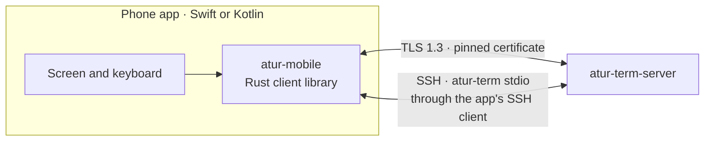
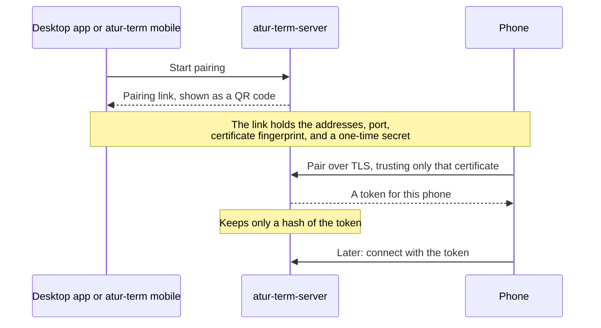

# Mobile

Phones connect straight to `atur-term-server` on the user's computer. There is no
cloud service. A phone connects in one of two ways:

- **Paired, over TLS.** The phone reaches the computer on the same network,
  through a VPN such as Tailscale, or at an address added to the pairing code.
- **Over SSH**, with the phone app's own SSH client. It runs `atur-term stdio` on
  the computer, like `atur-term --host` does, so no pairing or open port is needed.

## Pairing

The computer lists its own addresses. One that phones reach by another name,
such as a cloud server behind NAT, puts that name first with
`atur-term mobile pair --address`.

## Security

- Mobile access is off until the user turns it on.
- The phone trusts only the certificate named in the pairing code, so another
  machine can't pretend to be the computer.
- Each phone has its own token and can be revoked at any time. Revoking closes
  its connection at once.
- A connection that hasn't signed in gets nothing else from the server.
- Paired phones can't manage mobile access, change server settings, stop the
  server, or run programs outside a terminal (`exec`).
- A paired phone can view and control the computer's screen only while the
  computer allows it for that phone (`RequestBody::SetDeviceScreen`, local
  connections only). The permission is saved with the device, off by default,
  and turning it off ends the phone's open screen viewers at once.
- Over SSH, the phone logs in as the user and can do what that login can. Host
  keys and credentials stay in the app's SSH client.

## The SDK

- `atur-mobile` wraps the shared Rust client with UniFFI, which generates Swift
  and Kotlin bindings. Phones use the same protocol and flow control as the
  desktop app.
- The SDK keeps each attached screen up to date. The app draws it and sends
  input.
- Each release publishes the SDK for iOS and Android next to the desktop app.
  `scripts/build-mobile-sdk.sh` builds it locally.
- A phone works with any server that shares its protocol version, so phone
  releases only need to follow breaking protocol changes.

## UDP for paired phones

On a bad network the TLS connection stalls with every lost packet. A paired phone
therefore moves to the [UDP stream](./udp-transport.md#paired-phones-bootstrap-over-tls) after it
has connected over TLS:

1. The server lists `Feature::UDP_OFFER` in its `HelloReply`; the phone asks only
   a server that does.
2. `OfferUdp` over the authenticated connection returns a UDP port from
   `ATUR_TERM_UDP_PORTS` (default 60001-61000) and a fresh 256-bit key.
3. The phone sends to the host its TLS connection reached, signs in again over
   UDP with the same device credential, and drops TLS.
4. If anything fails (older server, `ATUR_TERM_UDP=0`, no answer in 3 s because the
   network blocks UDP) the TLS connection stays.

Everything above the connection (events, frames, predictive echo, scrollback) sees
the same client and is unchanged. In the facade, `connect` takes an optional
`"transport": "auto" | "tls"` in the credential JSON and answers
`{serverId, serverName, serverVersion, transport: "udp" | "tls", udpNote}`, where
`udpNote` says why UDP was not used and is empty when it was; `echoStats` also
reports `transport`. Revoking a device or turning mobile access off ends its UDP
connection as it ends a TLS one. On a firewall, UDP 60001-61000 (or the range you
set) must be open to the phone, which Tailscale does by itself.

## Choosing the route

A computer is usually reachable several ways at once (its address on the local network, its Tailscale
address, a `.local` name), and they differ in speed. Tailscale cannot connect two devices directly when the
phone itself hosts the hotspot the computer is on, so it relays through a server far away (123 ms in one
measurement) although the phone and the computer are 2.6 ms apart on the local link. The addresses saved
at pairing time were tried in order, one after another, so a stale or slow first address held everything
back.

`Client::connect_remote_at` therefore races the server's addresses (`muxy-client/src/race.rs`):

- **Ranking.** Local addresses first (RFC 1918, link-local, loopback, `.local` names), then Tailscale
  (100.64.0.0/10, its IPv6 range, `*.ts.net`), then everything else; each group keeps the saved order, and a
  repeated address is tried once. `race::plan` is the pure function with the ranking and the start times.
- **Stagger.** The first address starts at once, the next 150 ms later if nothing has signed in yet, and so
  on; an address that fails (refused, wrong certificate) starts the next one immediately instead of waiting.
- **Pinning.** Every attempt runs the same TLS handshake pinned to the certificate fingerprint stored at
  pairing, then Hello and the device sign-in. The first connection to finish all of that is kept and the
  others are closed; a wrong certificate is never trusted, and is reported as an identity mismatch only
  when no address worked. With one address nothing is raced and the behaviour is exactly the old one.
  Pairing races the link's addresses to the first TLS connection only, because its secret works once.
- **Answer.** The connection says which address won (`Route { host, kind, elapsed }`, `kind` from the host
  as ranked above); `elapsed` is that address's own connect, TLS and sign-in time.

### Learning the server's addresses

A pairing link lists the addresses the computer had that day. After connecting, a phone asks a server that
lists `Feature::SERVER_ADDRESSES` (3) for the addresses it would put in a pairing link now, so a new
hotspot or Wi-Fi address is used the next time without pairing again.

- `RequestBody::ReadAddresses` (variant 45, no fields) answers `ReplyBody::Addresses(ServerAddresses)`
  (variant 40): `{ hosts: [string], port: u16 }`, CBOR `[hosts, port]` with `hosts` an array of at most
  eight IPv4 addresses or DNS names (the same list, from the same code, as `atur-term mobile pair`: the
  address of the default route, the Tailscale address if there is one, then the machine's `.local` name).
  Only a paired network connection may ask; a local connection gets `BadRequest`, and a server without the
  feature is never asked. `Registry::with_address_source` replaces the lookup (tests; a server whose
  addresses are known by other means).
- The facade merges the answer with the stored hosts (`atur-mobile/src/route.rs`): the server's list
  first, then the winning address if the server did not list it, then the stored ones not in the list, each
  once and at most eight. `connect` returns it as `addresses`; the app persists it as the credential's
  `hosts`. It is only ever more addresses to try: the certificate fingerprint, the port and the device token
  never change.
- The connect answer is `{serverId, serverName, serverVersion, transport, udpNote, route: {host, kind:
  "local" | "tailscale" | "other", ms}, addresses, screen}` (`screen`: the server offers the
  [computer's screen](#the-computers-screen-on-the-phone)), and `echoStats` carries `route` too.

The route race has an integration test in `muxy-client/tests/remote.rs`: a proxy that holds connections on
`127.0.0.2` back, so the fast `127.0.0.1` wins even when listed second, and a server reachable only
through one address among refusing ones. The `route` job of `.github/workflows/mobile.yml` repeats it with
`scripts/route-netem.sh` delaying `127.0.0.2` by 120 ms each way (a `prio` qdisc with `u32` filters on that
address) and prints one `route race winner=<host> ms=<n>` line per race into the job summary.

The full integration guide, with the API, setup, and error handling, is in
[`crates/atur-mobile/README.md`](../../crates/atur-mobile/README.md).

## The React Native facade

`crates/atur-mobile/src/direct.rs` is the layer the Atur app's React Native module drives.
It exists so the Kotlin and Swift glue stays a few lines long and identical on both platforms:

- Everything crossing the boundary is a JSON string. `Direct::call` runs a request that may block,
  `Direct::fire` queues typing, paste and resize (answered at once, run in order on one thread), and a
  `DirectListener` receives pushed events. Answers are `{"ok": ...}` or `{"error": {"code", "reason"}}`.
- Attached screens are rendered to ANSI rows (`ansi.rs`) and only changed rows are sent, as `snapshot` and
  `diff` events, which is the vocabulary the Atur app already draws.
- `sessions` answers each live session with the terminal's own `title` (empty when it set none). The
  server pushes titles only for sessions a connection references, so listing references the unattached
  live sessions for a moment (one round trip plus the server's push), caches what arrives, and lets go
  again; later attaches and detaches keep the server's references equal to the attached terminals.
- Typing arrives as the byte strings a terminal emulator produces; `input.rs` turns them into text and key
  presses so the server encodes arrows and function keys with the program's own modes.
- The predictive echo (`muxy-client`'s `Predictor`) runs in the core: it sees every key sent and every
  frame received, and its guesses are drawn into the rows. A timer thread sleeps until the predictor's next
  deadline.
- `pasteImage` (`session`, `name`, `base64`) writes a pasted image into the computer's Home project at
  `.cache/atur/pastes/<name>` (5 MiB limit, plain file names only) through the project files API and answers
  with its absolute path, so image paste works on a direct connection without the bridge.

`.github/workflows/mobile.yml` checks the crate and builds the Android libraries and the iOS XCFramework on
hosted runners; `cargo test -p atur-mobile --test sdk bench_facade -- --ignored --nocapture` prints attach
and echo timings against an in-process server, and its `lossy` job runs `bench_facade_lossy` over TLS and
over UDP on a loopback link shaped to 800 ms round trip and 10% loss with a 10 s outage.

## The computer's screen on the phone

A paired phone can show the computer's desktop and drive it over the connection it already has, TLS or UDP.
The server side is the [screen channel](./protocol.md#screen-channel) (`OpenScreen`, `ScreenData` carrying the RFB bytes of
`wayvnc`); the server refuses a phone the user has not allowed (`ErrorCode::Unauthorized`, with the sentence
the app shows as it is) and closes a phone's viewers when the permission goes. The client side is
`atur-screen` (RFB, ZRLE, H.264 through a pluggable decoder, input) joined to the facade by
`crates/atur-mobile/src/screen.rs`:

- **Transport.** A `ScreenTransport` over `muxy_client::ScreenLink`: `send` writes `ScreenData`, `processed`
  reports handled bytes with a `FrameAck`, which is the flow control (the server never has more than a window
  of unreported bytes on the wire), `close` detaches the channel.
- **Media.** Foreign code implements one UniFFI trait, `ScreenSink` (`on_video(annex_b, reset)`,
  `on_frame(width, height, rgba)`), and gives it to `Direct::set_screen_sink`. A pump thread, woken by the
  session's `wake`, converts the newest BGRA picture to RGBA once and calls `on_frame` at most about 30 times
  a second; while the sink is busy newer pictures replace each other in the session's single slot.
- **H.264.** `screenOpen` with `h264: true` starts the session with `Screen::start_with_decoder` and a
  decoder that forwards every access unit (Annex B, the `reset` flag from the rectangle) to `on_video`; it is
  named `mediacodec` on Android, `videotoolbox` on iOS and `native` elsewhere in the statistics. The session
  acknowledges a chunk only after `decode` returned, so a slow hardware decoder slows the server down; no video
  is ever queued. `atur-screen` has no built-in decoder on Android and iOS (its `ffmpeg` decoder is for desktops
  only). With `h264: false` the core never offers H.264 and the server sends ZRLE. `screenRefresh` calls
  `Screen::refresh()`: a full non-incremental update request, which makes the server restart the stream with a
  key frame, as a decode failure does.
- **Requests.** `screenOpen` and `screenClose` are `call`s. The input (`screenPointer`, `screenScroll`,
  `screenKey`, `screenType`, `screenViewOnly`, `screenClipboard`, `screenReleaseAll`, `screenRefresh`) is `fire`d,
  queued in order with typing and ignored without a screen. Arguments and answers are in
  [`crates/atur-mobile/README.md`](../../crates/atur-mobile/README.md#the-computers-screen).
- **Events.** `{"t":"screen","state":"connecting"|"ready"|"closed", ...}` (`width`, `height`, `name` with
  `ready`, again when the desktop is resized; `reason` with `closed`, empty when the app closed it and else the
  server's own words), `{"t":"screenStats","codec","fps","kbps","dropped","decodeMs"}` once a second and
  `{"t":"screenClipboard","text"}`. The events of one screen are ordered and none follows its `closed`.
- **Errors.** `ScreenNotAllowed` (the server answered `Unauthorized`; `reason` is its sentence),
  `ScreenUnavailable` (any other refusal, such as `wayvnc` missing or no Wayland desktop; `reason` is the
  server's text) and `Unsupported` (the server lists no `Feature::SCREEN`). The connect answer's `screen`
  says whether it does.
- **Lifetime.** One screen per connection; opening another closes the previous one first (its `closed` event
  comes before the new `connecting`). `disconnect`, dropping the `Direct`, or losing the connection ends it.

`crates/atur-mobile/tests/screen.rs` runs all of this against an in-process server over TLS whose capture
program is a Python stand-in for `wayvnc` (`tests/fake_wayvnc.py`: ZRLE pictures, the H.264 fixture of
`atur-screen` as access units, input and clipboard logging). The example `phone_probe` drives a real
desktop the same way for the `screen-e2e` job of `.github/workflows/ci.yml` (`scripts/screen-e2e.sh`, a
headless sway with the real `wayvnc`): it pairs over TLS, is refused until the computer allows the phone,
sees the desktop's colour change over TLS and over UDP with H.264 offered or not, drives the desktop (checked
with `wev`) and loses the screen when the permission is taken away.
