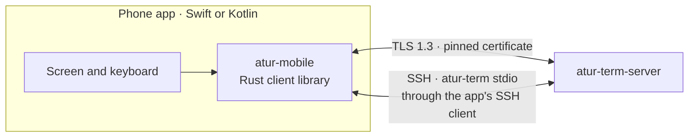
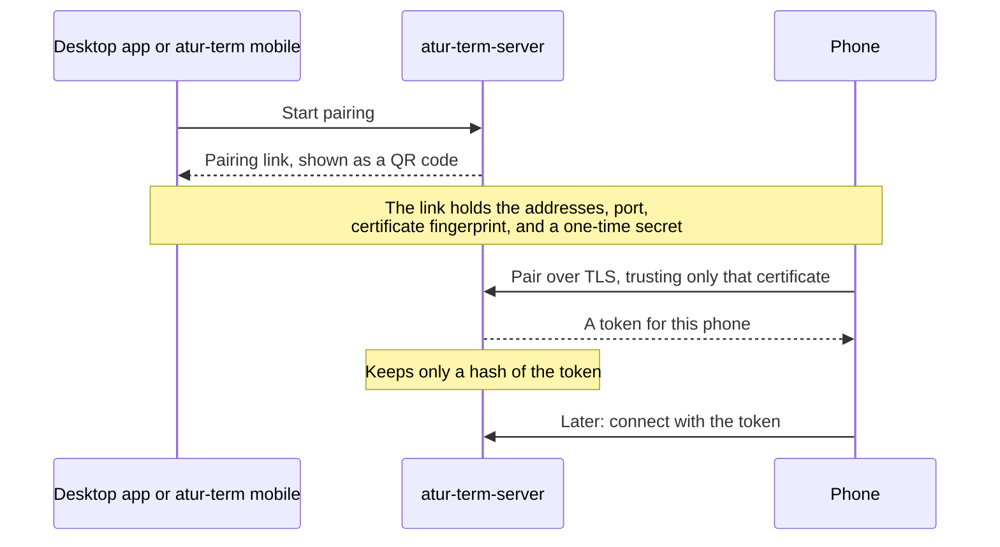

# Mobile

Phones connect straight to `atur-term-server` on the user's computer. There is no
cloud service. A phone connects in one of two ways:

- **Paired, over TLS.** The phone reaches the computer on the same network,
  through a VPN such as Tailscale, or at an address added to the pairing code.
- **Over SSH**, with the phone app's own SSH client. It runs `atur-term stdio` on
  the computer, like `atur-term --host` does, so no pairing or open port is needed.

## Pairing

The computer lists its own addresses. One that phones reach by another name,
such as a cloud server behind NAT, puts that name first with
`atur-term mobile pair --address`.

## Security

- Mobile access is off until the user turns it on.
- The phone trusts only the certificate named in the pairing code, so another
  machine can't pretend to be the computer.
- Each phone has its own token and can be revoked at any time. Revoking closes
  its connection at once.
- A connection that hasn't signed in gets nothing else from the server.
- Paired phones can't manage mobile access, change server settings, stop the
  server, or run programs outside a terminal (`exec`).
- Over SSH, the phone logs in as the user and can do what that login can. Host
  keys and credentials stay in the app's SSH client.

## The SDK

- `atur-mobile` wraps the shared Rust client with UniFFI, which generates Swift
  and Kotlin bindings. Phones use the same protocol and flow control as the
  desktop app.
- The SDK keeps each attached screen up to date. The app draws it and sends
  input.
- Each release publishes the SDK for iOS and Android next to the desktop app.
  `scripts/build-mobile-sdk.sh` builds it locally.
- A phone works with any server that shares its protocol version, so phone
  releases only need to follow breaking protocol changes.

## UDP for paired phones

On a bad network the TLS connection stalls with every lost packet. A paired phone
therefore moves to the [UDP stream](./udp-transport.md#paired-phones-bootstrap-over-tls) after it
has connected over TLS:

1. The server lists `Feature::UDP_OFFER` in its `HelloReply`; the phone asks only
   a server that does.
2. `OfferUdp` over the authenticated connection returns a UDP port from
   `ATUR_TERM_UDP_PORTS` (default 60001-61000) and a fresh 256-bit key.
3. The phone sends to the host its TLS connection reached, signs in again over
   UDP with the same device credential, and drops TLS.
4. If anything fails (older server, `ATUR_TERM_UDP=0`, no answer in 3 s because the
   network blocks UDP) the TLS connection stays.

Everything above the connection (events, frames, predictive echo, scrollback) sees
the same client and is unchanged. In the facade, `connect` takes an optional
`"transport": "auto" | "tls"` in the credential JSON and answers
`{serverId, serverName, serverVersion, transport: "udp" | "tls", udpNote}`, where
`udpNote` says why UDP was not used and is empty when it was; `echoStats` also
reports `transport`. Revoking a device or turning mobile access off ends its UDP
connection as it ends a TLS one. On a firewall, UDP 60001-61000 (or the range you
set) must be open to the phone, which Tailscale does by itself.

The full integration guide, with the API, setup, and error handling, is in
[`crates/atur-mobile/README.md`](../../crates/atur-mobile/README.md).

## The React Native facade

`crates/atur-mobile/src/direct.rs` is the layer the Atur app's React Native module drives.
It exists so the Kotlin and Swift glue stays a few lines long and identical on both platforms:

- Everything crossing the boundary is a JSON string. `Direct::call` runs a request that may block,
  `Direct::fire` queues typing, paste and resize (answered at once, run in order on one thread), and a
  `DirectListener` receives pushed events. Answers are `{"ok": ...}` or `{"error": {"code", "reason"}}`.
- Attached screens are rendered to ANSI rows (`ansi.rs`) and only changed rows are sent, as `snapshot` and
  `diff` events, which is the vocabulary the Atur app already draws.
- `sessions` answers each live session with the terminal's own `title` (empty when it set none). The
  server pushes titles only for sessions a connection references, so listing references the unattached
  live sessions for a moment (one round trip plus the server's push), caches what arrives, and lets go
  again; later attaches and detaches keep the server's references equal to the attached terminals.
- Typing arrives as the byte strings a terminal emulator produces; `input.rs` turns them into text and key
  presses so the server encodes arrows and function keys with the program's own modes.
- The predictive echo (`muxy-client`'s `Predictor`) runs in the core: it sees every key sent and every
  frame received, and its guesses are drawn into the rows. A timer thread sleeps until the predictor's next
  deadline.
- `pasteImage` (`session`, `name`, `base64`) writes a pasted image into the computer's Home project at
  `.cache/atur/pastes/<name>` (5 MiB limit, plain file names only) through the project files API and answers
  with its absolute path, so image paste works on a direct connection without the bridge.

`.github/workflows/mobile.yml` checks the crate and builds the Android libraries and the iOS XCFramework on
hosted runners; `cargo test -p atur-mobile --test sdk bench_facade -- --ignored --nocapture` prints attach
and echo timings against an in-process server, and its `lossy` job runs `bench_facade_lossy` over TLS and
over UDP on a loopback link shaped to 800 ms round trip and 10% loss with a 10 s outage.
