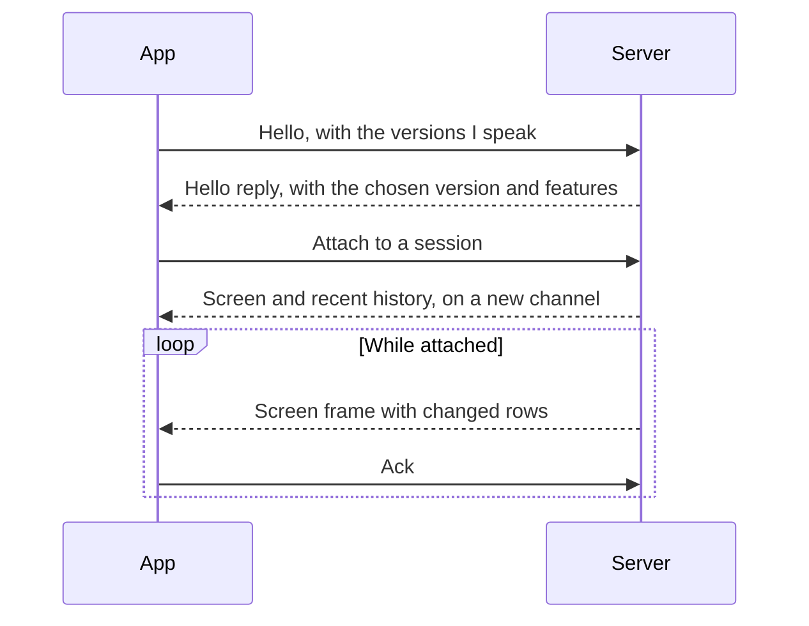
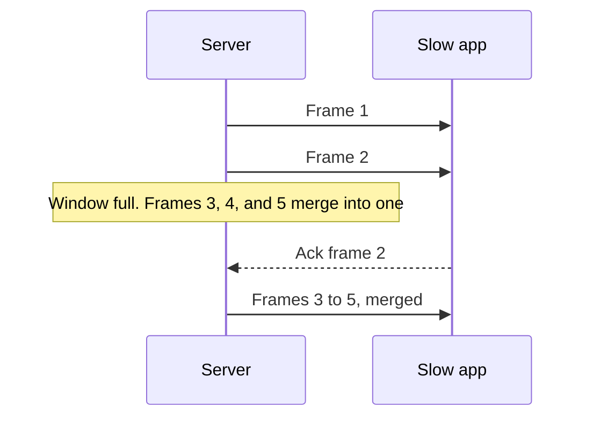
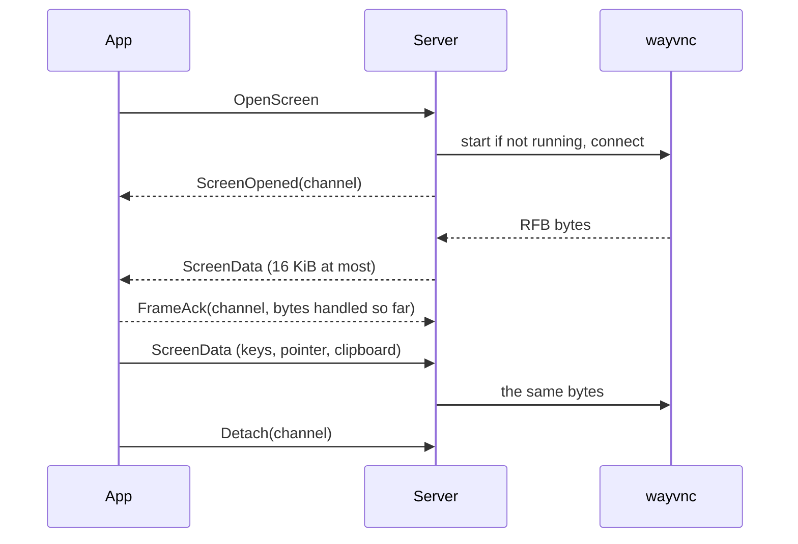

# Protocol

How apps and the server talk. The exact messages live in `crates/muxy-protocol`.

## Connection

- The connection is a reliable byte stream: a Unix socket on the same computer,
  SSH to `atur-term stdio` on another computer, encrypted UDP that ssh sets up
  for [bad networks](./udp-transport.md), or TLS for [paired phones](./mobile.md).
- Traffic is split into channels. Channel 0 carries control messages, and each
  attached session gets its own channel for screen updates and input.
- Every frame starts with a small header: length, protocol version, channel, and
  message kind. Messages are CBOR with numbered fields. Screen rows use postcard.

## Requests and replies

- Every request carries an ID and gets exactly one reply, in any order.
- A bad request, such as an unknown session or an invalid path, gets an error
  reply and the connection stays open.
- A request the server doesn't know gets an "unsupported" reply. That is how an
  older server answers a newer app.
- Malformed traffic closes the connection.
- For shared state, such as projects, sessions, and AI activity, the server
  sends a short "changed" notice and apps read the new state again.

## Screen updates

- A row is a list of style runs: text, its style, and its cell widths. Apps need
  no Unicode width tables.
- Frames carry only the visible rows that changed. A resize sends the whole
  screen.
- History is never pushed. Apps page through it and search it on request.

## Session size

Several apps can show one session, but it has one size. The protocol is
unchanged; the server decides whose size it is.

- Every app tells the server the grid its view has: `Attach` with a size, then
  `Resize` when that grid changes. An app sends `Resize` only for a change of its
  own grid, never because it attached, took focus or redrew. Telling the same
  size twice is a no-op, and the reply is the whole screen at the session's size.
- Only the app whose keyboard the session follows may make the session that
  big. That is the app that typed last (a key or a paste, not focus or mouse
  events), once the previous typist has been quiet for 0.8 s, so two people
  typing at once do not make the pane flip. The server keeps each app's last
  told size and applies it the moment the app takes the keyboard.
- An app that never typed only watches. Before anyone types, desktop and
  terminal apps keep the old behaviour (the last size told wins), so a lone
  desktop sizes its session as it always did. A phone (client kind `Mobile`)
  always starts as a watcher; even its first `Attach` leaves the session's
  size alone.
- A `Resize` that the session does not take is still answered, with a reset
  frame at the session's size. Apps follow a reset frame's size, so a watcher
  shows the session as it is.
- When the typing app detaches, the keyboard is free and the next app to type
  takes it.

With the herdr backend the same rule decides who controls herdr's terminal; see
[the herdr backend](herdr-backend.md#session-size-and-watchers).

## Flow control

Each attached session has a window of frames in flight to each app: at most 8
frames and about 256 KiB. Output that arrives while the window is full merges
into a single waiting frame. An ack of a frame's number also acknowledges every
earlier frame, and apps that ack each frame in order work unchanged.

Memory stays small, and a slow app jumps straight to the latest screen. The
window also keeps a link with a long round trip busy, where one frame per ack
would cap the frame rate at one per round trip. Control messages are always
written first. Wire compression is planned but not built yet.

## Screen channel

A server on Linux with a Wayland desktop can mirror that desktop to a client over
the connection it already has, whether that is ssh, [UDP](./udp-transport.md) or a
local socket. It is a separate feature, `Feature::SCREEN` (4), listed in the
handshake only by servers that can do it.

- `OpenScreen` (request 46, no fields) answers `ScreenOpened` (reply 41, the new
  channel) or an error whose message says why the desktop can't be mirrored: no
  Wayland session, `wayvnc` not installed, not Linux. Local and ssh connections
  may ask. A paired phone may ask only while the computer allows its screen
  (`PairedDevice.screen`); otherwise the server refuses with `Unauthorized` and
  says where to allow it. Turning the permission off, or revoking the phone,
  ends its open screen viewers at once.
- `SetDeviceScreen` (request 47: device ID, allowed) sets that permission and
  answers `RemoteAccess` with the new state. Only local connections may ask:
  a phone can't grant itself the screen. The permission is saved with the
  device and is off for every phone until the computer allows it.
- `ScreenData` (message 24) is raw bytes, like `Input`, in both directions: the
  RFB conversation of one viewer. The server never interprets it. `ScreenClosed`
  (message 25, a reason that is empty for a normal end) follows the last bytes
  when `wayvnc` ends or stops reading.
- **Flow control.** The server queues at most 512 KiB of a viewer's bytes, counting
  bytes on the wire that the client has not reported. The client reports with
  `FrameAck`, whose `seq` for a screen channel is the total bytes it has handled,
  and sends it after it has decoded what it received, not when it arrived. Beyond
  the window the server stops reading `wayvnc`, whose own socket then fills and
  makes it send only the newest picture when the client catches up. Nothing is
  ever dropped from the byte stream, so the RFB messages inside stay whole, and
  there is never more than a fraction of a second of video in flight.
- `Detach(channel)` ends a viewer; a connection that closes ends all of its viewers.
- `wayvnc` starts for the first viewer and stops 15 seconds after the last one.
  It listens on a Unix socket in a private (mode 0700) folder of the runtime
  directory, or on 127.0.0.1 for a `wayvnc` too old for sockets, and never on
  another address. Several viewers share one `wayvnc`.

## Versions

Two builds can talk when they share a protocol version, currently V2. Only a
breaking change bumps the version. Fields and enum values have permanent numbers
that are never reused, so a build skips fields it doesn't know and shows unknown
values neutrally.

| Change | Bumps the version? |
| --- | --- |
| Add an optional field or one with a default | No |
| Add an enum value | No |
| Add a request | No. Older servers reply "unsupported" |
| Add something the server must act on | No. Add it as a new request or feature, since older servers ignore unknown fields |
| Remove something | No. Stop using it and keep its number reserved |
| Change a type or meaning, make a field required, or change screen rows or the header | Yes |

Encoded samples of each version are kept in
`crates/muxy-protocol/tests/fixtures/v<N>` and are only ever added to. CI
checks that the current build reads every sample and that the last release
reads the current ones. Saved user data must never be lost when a format
changes.
