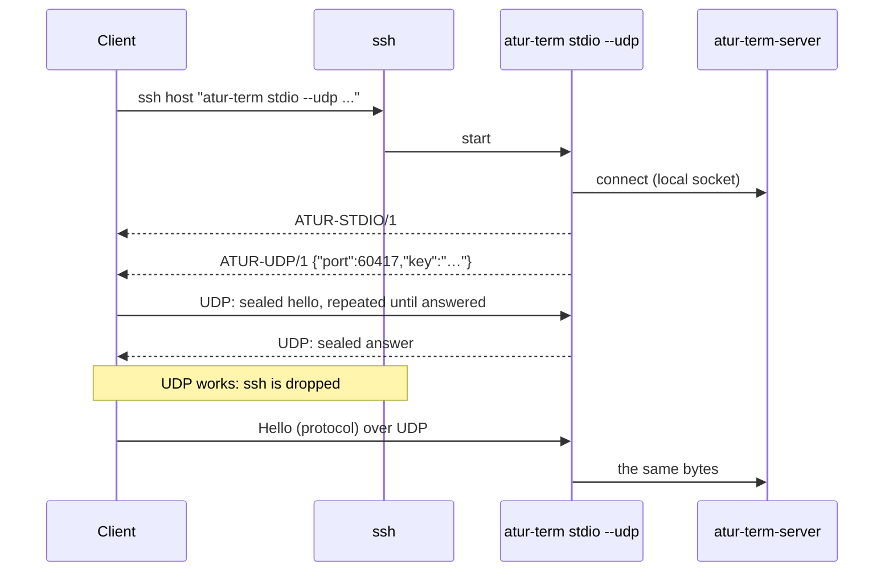
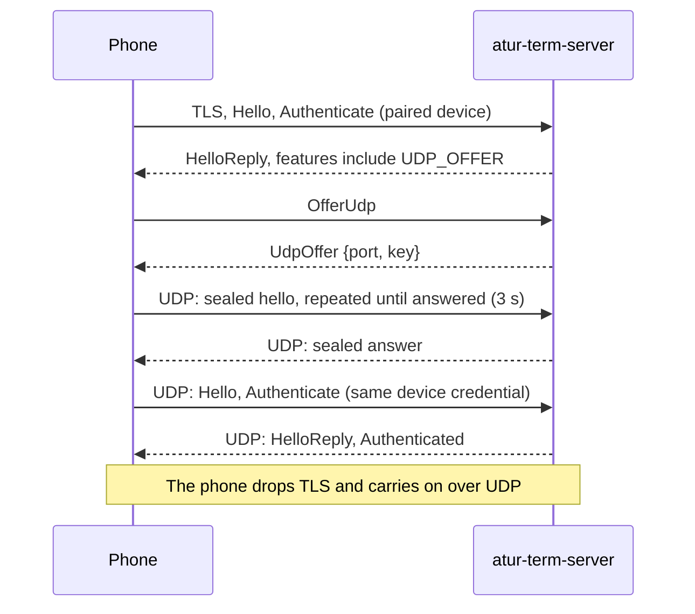

# UDP transport

How a connection to a server on another computer survives a bad network. The
[protocol](./protocol.md) is unchanged; only the byte stream under it differs.
For setup and ports, see [Remote servers](../features/remote-servers.md#on-slow-or-unreliable-networks).

## The problem

Over ssh, the client talks to `atur-term stdio` through TCP. On the link that
prompted this work (SSH round trip 0.8 to 1.3 s, 2 to 20% retransmits, 4.7 Mbps
usable, Wi-Fi spikes to 0.7 s), TCP does three things wrong for a terminal:

1. **Loss stalls everything.** One lost segment holds back every byte behind it
   until the retransmit arrives, and TCP backs its retransmit timer off
   exponentially, so a few losses in a row cost seconds.
2. **A change of network ends the connection.** The connection is a pair of
   addresses. A new Wi-Fi network, or a laptop's sleep, kills it.
3. **Nothing is sent early.** Every keystroke waits a whole round trip to learn
   whether it arrived.

mosh's answer, which this follows, is a datagram transport under the application,
authenticated by a key ssh carries, with timers made for loss and for a client that
moves. What it does not copy is mosh's state synchronization: the protocol here
is a byte stream, and the server's own frame window and merging already stop a slow
link from piling up stale screens.

## Shape

- **Bootstrap.** The client runs the bridge with `--udp`. After its ready line the
  bridge prints `ATUR-UDP/1 {"port":N,"key":K}`: a random port from its range and
  a fresh 256-bit secret. ssh authenticated the host and the user, and carries
  the secret to the client; nothing else does.
- **Address.** The client sends to the host `ssh -G` resolves for the destination,
  at that port, or to `ATUR_TERM_UDP_HOST`. Dual-stack servers answer on IPv4 and
  IPv6.
- **First contact.** The client sends a sealed hello at 0, 100, 250, 500 ms and so
  on, until a sealed answer arrives or 3 seconds pass.
- **Success.** The client kills its ssh process and speaks the protocol over UDP.
  The bridge, which has been waiting on ssh and on the UDP port at once, sees the
  first protocol bytes arrive on UDP, detaches from ssh's session
  (`setsid`, standard streams to `/dev/null`), and serves UDP.
- **Fallback.** If nothing answers, the client carries on over the ssh stream it
  already has, and notes `UDP unavailable (…)` once. The bridge sees the first
  protocol bytes arrive on ssh, closes its UDP port, and serves ssh as before.
  Whichever path carries the first byte wins, so neither side can be left on a
  different transport than the other. A bridge that cannot bind a port says so
  in its offer (`ATUR-UDP/0 reason`) and serves ssh at once. A server too old
  to know `--udp` rejects the flag, and the client retries without it.

## Security

- **Encrypted and authenticated.** Every datagram is ChaCha20-Poly1305 sealed. The
  two directions use separate keys, HKDF-SHA256 derived from the secret, so a
  packet can never be reflected back. The nonce is a per-direction 64-bit
  counter, carried in the clear, and a 2048-packet window refuses repeats and
  anything older.
- **No handshake to attack.** The first packet is already a sealed data packet. A
  packet that does not open is dropped without a reply, so a scanner learns
  nothing and the port cannot be used for amplification. Nothing unauthenticated
  reaches the server socket: the bridge forwards only bytes from sealed packets,
  and only after one has opened.
- **Rate limit.** Packets from the address the client was last heard at are always
  tried. From any other address the bridge examines at most 50 packets a second,
  with a burst of 100, so a flood of garbage costs it a bounded amount of
  decryption and cannot starve the real client.
- **Single use.** The secret exists for one bridge process. A bridge serves one
  client: later packets from a new address only count if they are authentic and
  newer than any before. The client's process holds the secret and the counters,
  so a second client cannot appear with the same key, and the secret never
  reaches a log or a file. A bridge that nobody contacts within 60 seconds
  exits.
- **Not TLS.** The secret rides ssh, which already authenticates both ends, so no
  certificate, trust prompt or extra round trip is needed. The cost: there is no
  forward secrecy against someone who both recorded the UDP traffic and later
  obtains the secret from the client's memory. Recorded traffic alone is
  useless without it.

## The stream

`transport/udp/connection.rs` is a sans-IO state machine: a reliable, ordered
byte stream with the usual machinery (sequence numbers, cumulative and selective
acks, a congestion window, pacing, flow control) and timers made for this link.
The simulator in its tests, a virtual clock with delay, jitter, loss and outages,
checks each of the properties below.

| What | How | Why |
| --- | --- | --- |
| Loss detection | A packet is lost once a later one was acknowledged and its own ack is a round trip plus a reordering allowance overdue | Does not wait for three duplicate acks, which a keystroke will never produce |
| Probes | With nothing acknowledged for one round trip plus twice the variance, resend the oldest unacknowledged bytes | A lost tail packet is found without waiting for a retransmission timeout |
| After the first probe | Every quarter second while the peer is silent for less than 20 s, then every half second, second, and at most every two seconds | Exponential backoff would leave a link that returned unnoticed for seconds. Silence is cheap to probe, and a sleeping peer is not flooded |
| Link back | The first packet after three unanswered probes sends everything in flight again at once | That data went into a dead link |
| Round trips | Echoed timestamps, not packet timing | A retransmission never makes a sample ambiguous |
| Small packets | Up to 512 bytes: sent again after a few ms. Up to 256: and a third time half a round trip later | Keystrokes, acks and echoes are tiny. Two or three independent chances turn 10% loss into 1% or 0.1% with no wait. The third copy is far enough behind to miss a burst |
| Congestion window | NewReno-like, never below 16 packets | On a link that loses packets at random, collapsing the window starves the terminal for nothing |
| Pacing | Twice the window per round trip, with a burst of four | Spares a router's queue |
| Heartbeat | A client sends one every 2 s when idle, every quarter second once the server has been silent for longer | Keeps a NAT mapping open, tells the server where the client is and when it is gone |
| Flow control | The receiver advertises free buffer; the writer blocks when the send buffer is full | The server's own window sees back-pressure instead of memory growing |

The simulator's one-way delivery times for 16-byte messages (150 and 400 ms mean
one-way delay):

| Link | p50 | p90 | p99 | worst |
| --- | --- | --- | --- | --- |
| 50 ms RTT, no loss | 25 ms | 25 ms | 25 ms | 25 ms |
| 300 ms RTT, 5% loss | 150 ms | 150 ms | 169 ms | 300 ms |
| 800 ms RTT, ±400 ms jitter, 10% loss | 300 ms | 558 ms | 782 ms | 1.78 s |

## Roaming and sleep

The server learns where the client is from the newest authentic packet, never
from an address it was told. A client that changes network, such as from Wi-Fi to
a hotspot, keeps sending from its wildcard-bound socket, which the system routes
over the new interface; the server answers wherever the newest packet came from.
A client that hears nothing for 6 seconds opens a new socket, in case the old one
is tied to a network that is gone.

The server keeps the connection to `atur-term-server` for an hour after the
client's last packet (`--udp-idle`). The client counts only time the computer is
awake, so a sleep does not use up its five minutes (`ATUR_TERM_UDP_TIMEOUT`). When
the five minutes run out the connection fails like an ssh drop would, and the
usual reconnect starts a fresh bridge. The old one exits at its own idle limit.
The sessions themselves never depended on the bridge: they live in
`atur-term-server`.

## Paired phones: bootstrap over TLS

A phone has no `ssh` to carry the secret, but it already holds a pinned TLS
connection that authenticated it as a paired device. That connection carries the
offer instead (see [Mobile](./mobile.md)). The stream under the protocol is the
same one; only the bootstrap and the way the server picks it up differ.

- **The request.** `RequestBody::OfferUdp` (variant 44, no fields) answers
  `ReplyBody::UdpOffer { port: u16, key: [u8; 32] }` (variant 39, fields
  `[port, key]`, the key a CBOR byte string). Only network connections of a paired
  device may send it; a local connection gets `BadRequest`.
- **Older servers are never asked.** The server lists `Feature::UDP_OFFER` (2) in
  its `HelloReply`. A phone asks only when the feature is there, so an older server
  keeps its TLS connection without ever seeing the request (and a server that does
  receive an unknown request answers `Unsupported`, as for every unknown request).
  A server with UDP turned off (`ATUR_TERM_UDP=0`) lists the feature but answers
  `Unsupported`, which the phone reports as "turned off".
- **The port.** The server binds one UDP port from `ATUR_TERM_UDP_PORTS`
  (`LOW-HIGH`, default 60001-61000) with a fresh 256-bit secret, per offer. The
  offer is closed after 30 seconds if nobody contacts it, or earlier when the
  connection that asked ends. A device may have two offers waiting, the server 16.
- **Address.** The phone sends to the host that its TLS connection actually reached
  (the first of the pairing code's addresses that answered), at the offered port.
- **Authentication.** The secret only seals datagrams. When the first one opens,
  the stream is served by the same `serve_remote` as a TLS connection: it takes one
  of the same unauthenticated-connection slots, must say Hello and
  `Authenticate` with the device credential within the same 10 s, and is a connection
  of that device for everything that follows. Revoking the device or turning mobile
  access off closes its UDP connection with its TLS ones.
- **Fallback.** Any failure keeps TLS: no feature, `Unsupported`, no answer in 3 s
  (a firewall that drops UDP), or a failed sign-in. The phone's `connect` answer
  names which transport it ended on and, when it is TLS, why. On success the phone
  closes its TLS connection before `connect` returns.
- **Time.** A client that hears nothing for 5 minutes of awake time reports the
  connection lost and the app's usual reconnect starts (TLS again, then UDP). The
  server drops a phone it has not heard from for 10 minutes (`ATUR_TERM_UDP_IDLE`
  changes it); the app closes its connection after 30 seconds in the background.
- **Roaming** needs nothing more than the stream: a phone that moves from Wi-Fi to
  cellular keeps its connection, which a TLS connection to the same address does not.

The core measures it with `cargo test -p atur-mobile --test sdk bench_facade_lossy
-- --ignored --nocapture` (set `ATUR_BENCH_TRANSPORT` to `tls` or `udp`). The
`lossy` job of `.github/workflows/mobile.yml` runs it with
`scripts/lossy-netem.sh` shaping only the bench's two ports on loopback: 400 ms
each way with 200 ms of jitter and 5% loss (about 800 ms round trip, 10% round-trip
loss), and a 10 s outage with iptables. During the outage the bench types a marker
character every 500 ms and drains the events; recovery is the time from the end of
the outage to the first marker on the screen (local echo is off, so a guess cannot
end it). When the connection dies it connects again with the same credential after
the outage and counts up to the first marker typed on the new connection. It prints
`lossy tls|udp echo n=… p50_ms=… p90_ms=… max_ms=…` and
`lossy tls|udp recovery_ms=… reconnected=true|false` into the job summary.

## Why not QUIC

QUIC (quinn: TLS 1.3, streams, congestion control, connection migration) was the
first candidate. It was measured, not ruled out by taste: see
`scripts/transport-lab/pingpong`. It keeps timers that TLP and RFC 9002 set for
bulk traffic, in particular a probe timeout of the smoothed round trip plus four
times its variance, doubled after each loss, that cannot be tuned from outside the
crate. A keystroke lost on a link with a round trip near a second waits that
long and then twice that. The table under "The stream alone" has the result.

Using QUIC's unreliable datagrams for screen frames would avoid the stall, but
the protocol's frames carry only the rows that changed, so a lost frame cannot be
dropped without the server and client agreeing on what the client has. The
server's window and merging already give "latest wins" without that, as long as
the stream under it recovers quickly.

A custom stream costs about two thousand lines and a simulator. In return it
works with the Atur Terminal server unchanged, needs no TLS certificates, no X.509 or ALPN
negotiation, and no extra handshake round trip.

## Measurements

Measured in a private user, mount and network namespace whose loopback interface
is shaped by netem, so ssh, sshd and the UDP stream meet real kernel loss, delay
and jitter, with nothing on the real network. Each row is one run of
`scripts/transport-lab/run.sh`: a shell session in the server, 40 keystrokes
typed 250 to 400 ms apart, a program printing the time ten times a second for
25 s, and then a 10 s outage. The host was busy (load average 40 to 80), so
single-run tails are noisy.

### The whole stack

`atur-term` connecting to a server over ssh and over UDP, same lab, same run.
Times in milliseconds. Echo is from sending a key to seeing it drawn, with no
prediction; staleness is how old the 10 Hz program's time looked on screen,
sampled every 25 ms; recovery is from the network coming back to a screen
showing output produced after that.

| Link | Transport | Echo p50 | p90 | worst | Stale p50 | p90 | worst | Recovery after 10 s down |
| --- | --- | --- | --- | --- | --- | --- | --- | --- |
| 50 ms RTT, no loss | ssh | 53 | 59 | 68 | 93 | 143 | 200 | 8,266 |
| | **UDP** | 53 | 59 | 70 | 85 | 135 | 172 | **303** |
| 300 ms RTT ±60, 5% loss | ssh | 313 | 379 | 881 | 259 | 570 | 1,104 | 8,807 |
| | **UDP** | 302 | 339 | 439 | 216 | 280 | 416 | **730** |
| 800 ms RTT ±400, 10% loss | ssh | 918 | 2,700 | 4,105 | 1,758 | 2,966 | 5,205 | 11,717 |
| | **UDP** | 741 | 996 | 1,249 | 519 | 792 | 2,143 | **2,230** |

- At 800 ms, ssh stalled typing for up to 4.1 s and the screen for up to
  5.2 s; UDP's worst was 1.2 s and 2.1 s, and its echo median is at the
  round trip (741 ms for a mean of 800, since jitter helps the quicker echoes).
- Recovery on ssh was 8 to 12 s in these runs, and 26 s in another at 800 ms: TCP's
  retransmit timer had backed off by the time the link returned. On UDP it is
  the round trip plus a probe, plus the Atur Terminal server's own round trip to hand out
  the next frame once the stale ones are acknowledged. Five runs at 800 ms
  gave 1.5, 1.7, 1.9, 2.2 and 2.3 s, median 1.9 s; at 300 ms 0.7 s.
- At 50 ms with no loss UDP costs nothing: the same echo, and a connection that
  took 0.8 s against 1.0 s for ssh alone (ssh dominates both).
- Both rows of each pair were measured in the same debug build, with the host
  busy; single-run tails vary by a few hundred ms. Connecting takes the ssh login
  plus one UDP round trip.

### The stream alone

A 16-byte request and its echo every 250 to 400 ms, 120 of them, over a
loopback interface shaped the same way (`scripts/transport-lab/pingpong.sh`),
round trip in milliseconds. This is the measurement that chose the transport.

| Link | Transport | p50 | p90 | p99 | worst |
| --- | --- | --- | --- | --- | --- |
| 50 ms RTT, no loss | TCP | 50 | 57 | 73 | 101 |
| | QUIC (quinn) | 52 | 57 | 74 | 76 |
| | **UDP stream** | 51 | 56 | 78 | 82 |
| 300 ms RTT ±60, 5% loss | TCP | 305 | 351 | 1,207 | 1,472 |
| | QUIC (quinn) | 303 | 995 | 1,769 | 1,830 |
| | **UDP stream** | 296 | 331 | 351 | 360 |
| 800 ms RTT ±400, 10% loss | TCP | 893 | 2,936 | 5,878 | 7,446 |
| | QUIC (quinn) | 841 | 3,002 | 6,892 | 7,334 |
| | **UDP stream** | 746 | 943 | 1,144 | 1,198 |

QUIC matches TCP on a clean link and is no better under loss: its probe
timeout, the smoothed round trip plus four times its variance and doubled after
each loss (RFC 9002), is not a setting in quinn's `TransportConfig`. TCP's
retransmit timer has the same arithmetic.

## Code

| Where | What |
| --- | --- |
| `muxy-protocol/src/transport/udp/crypto.rs` | Sealing, key derivation, replay window |
| `muxy-protocol/src/transport/udp/connection.rs` | The stream state machine and its simulator tests |
| `muxy-protocol/src/transport/udp/endpoint.rs` | Sockets, threads, roaming, the listening and connecting ends |
| `muxy-client/src/udp.rs` | The offer line, settings, and the bridge's side of the choice |
| `muxy-client/src/bridge.rs`, `ssh.rs` | Asking for UDP, and moving to it or not |
| `muxy-server/src/udp.rs` | Answering `OfferUdp`: the port, the secret, serving the claimed stream |
| `muxy-client/src/remote.rs` | `request_udp` and `connect_remote_udp` for a paired device |
| `atur-mobile/src/connection.rs` | `connect_direct`: TLS first, then UDP, TLS kept on any failure |
| `muxy-cli/examples/transport_lab.rs`, `scripts/transport-lab` | The lab |
